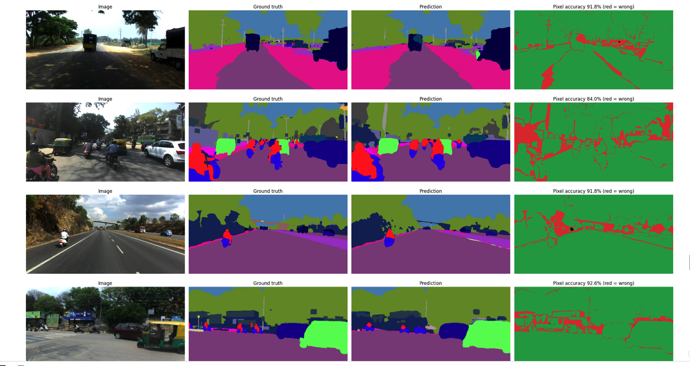

# RoadVision
### Deep Learning-Based Indian Road Scene Understanding

RoadVision performs pixel-level segmentation of Indian road scenes using the India Driving Dataset (IDD).

## Models & Results

- **DeepLabV3+**
- **ResNet50** 

## Prediction

The visualization compares the original road image, ground-truth mask, model prediction, and pixel-level errors.

## Data Preprocessing

- Converted JSON polygon annotations into pixel-level segmentation masks.
- Resized images and masks and mapped objects to class IDs.
- Prepared image-mask pairs for training and validation.

